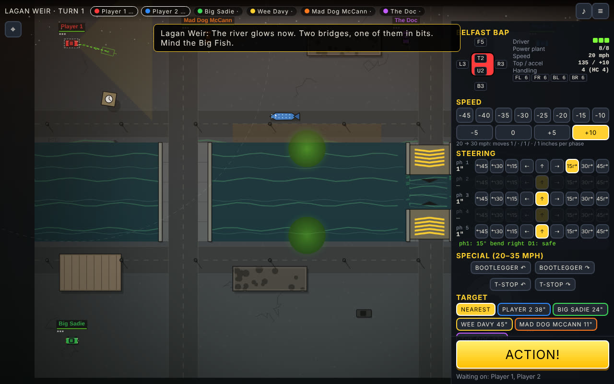
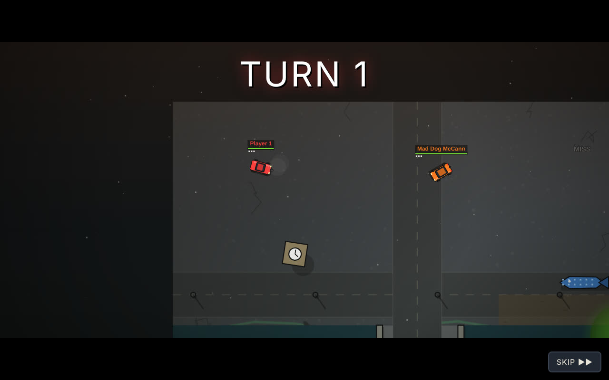
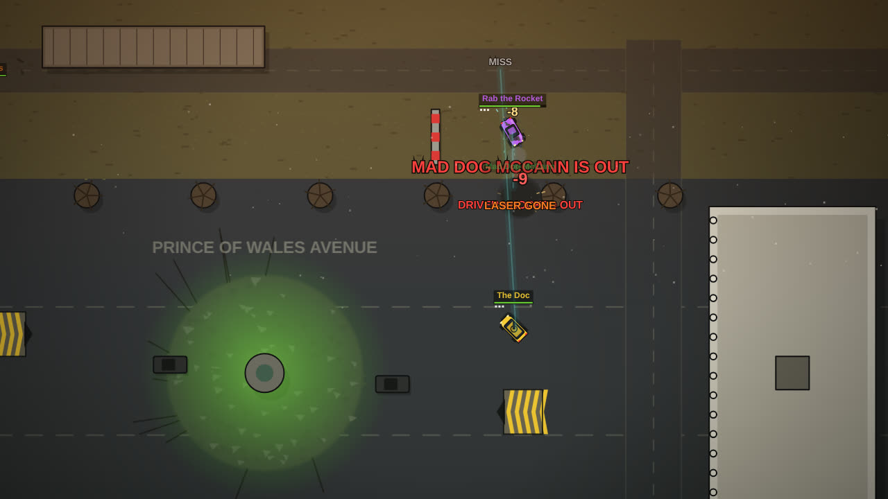

# Car Carnage: Belfast Edition



Eight-player car combat in post-nuclear Belfast, adapted from the *Car Wars* classic rules
(Steve Jackson Games). It is turn-based: every driver sets their speed, steering and fire orders in
secret, hits **ACTION**, and when everyone has, all cars move at once and the second plays out in
real time with the works: tracers, lasers, rockets, fire, explosions, rolls, jumps, slow motion and a
pumping synthesised soundtrack. When the match is over you can watch the whole thing back as a
film, together, or skip it.

Everything is vector art drawn in code and all the sound is synthesised, so the game is a handful of
plain JavaScript files with no build step and no dependencies.

## Play

**Online, up to 8 people**

```
cd car-carnage-belfast
node server.js
```

Open the address it prints (for example `http://192.168.1.20:8080`), press **PLAY ONLINE** and
**HOST A GAME**. Friends open the same address and join with the four-letter room code, or with the
link `http://192.168.1.20:8080/ABCD`. The host picks the arena and the rules, adds bots to fill empty
seats, and starts once everyone is ready. Node 18 or newer, nothing to install.

**On one device**

Press **PLAY ON THIS DEVICE** for pass-and-play: each human sets their orders behind a hand-over
screen, bots take the rest of the seats. This also works straight from the files with no server at all
(open `web/index.html`, or host the `web` folder anywhere static, such as itch.io).

## How a turn works

A turn is one second of the fight in five phases, as in *Car Wars*.

* **Speed.** Accelerate once per turn up to your car's rating. Braking 10 mph is free; harder
  braking is a manoeuvre with a difficulty and, past 30 mph, tyre damage. Your speed decides how many
  inches you move in each phase (the Movement Chart): 30 mph is 1" in phases 1, 3 and 5.
* **Steering.** One manoeuvre per phase you move at least 1": bends of 15° to 45° (D1 per 15°),
  drifts (D1), and at 20–35 mph the bootlegger reverse (D7) and the T-stop. The orders panel shows the
  predicted path on the map and the control roll each move needs before you commit.
* **Control.** Manoeuvres and hazards knock your handling status down; the Control Table (speed
  against status) says whether you keep it. Fail and the crash tables decide: skids, spinouts, rolls,
  or being vaulted into the air. Status recovers by your handling class each turn.
* **Shooting.** Every weapon fires once per turn at your target, in the first phase it has a clear
  line of fire inside its arc. Two dice against the to-hit number with the rulebook modifiers (range,
  target speed and size, your own manoeuvring, smoke, sustained fire, targeting computers). Damage
  takes armour on the side hit, then weapons, power plant and driver behind it. Tyres can be aimed at.
  Dropped weapons (oil, flaming oil, smoke, paint, mines, spikes) go out in the phase you choose.
* **Collisions.** Ram damage by speed and weight, with head-on, rear-end, T-bone and sideswipe
  handled as in the rules, and the Temporary Speed Table for what is left of your speed. Weak walls
  (terraces, shop fronts, bus shelters) can be smashed through; buildings stop you dead.
* **Fire.** Flamethrowers, flaming oil and lasers can set a car burning; burning cars lose a point
  everywhere each turn and may explode if they carry rockets or flame weapons.

Last car that can move or shoot wins; at the turn limit, most kills then most damage dealt.

When the match ends the host chooses whether everyone watches it back. The film plays every turn in
order with a camera that follows whoever is in the thick of it, slow motion on the big hits, turn
cards and captions for the kills. Anyone can skip to the standings.



## The arenas

Seven arenas, each 600 by 450 feet of Belfast after the bombs:

| Arena | What is there |
| --- | --- |
| Titanic Quarter | Samson and Goliath, the slipways, Titanic Belfast, a flooded dry dock you can jump |
| City Hall Crater | Donegall Square with the dome in a crater, shop fronts to drive through |
| Lagan Weir | The glowing river, Queen's Bridge, the broken footbridge (a jump), the Big Fish, the Albert Clock |
| Peace Line | A peace wall with three gates, rows of terraces, bonfires and waste ground |
| Cave Hill | Off-road up the mountain: boulders, gorse, streams, the castle, a fallout crater under the Nose |
| Stormont Avenue | A mile of straight road for top speed, Carson in the middle, Parliament at the top |
| Crumlin Road Gaol | The prison yard: the Circle and its wings, a perimeter wall, watchtowers |

Green pools are fallout (tyres suffer), blue water drowns anything without off-road suspension,
striped ramps are jumps: hit one at 20+ mph and fly 1" for every 10 mph over 20.

## The cars

Sixteen stock vehicles from the rulebook's sample list with Belfast names, from the Belfast Bap
(a Killer Kart: one machine gun, tinfoil armour, 135 mph) to the Harland Hammer (a Ventura pickup
with an autocannon and a turreted Vulcan) and the Blitz Trike (four linked rocket launchers). The
**GARAGE** builds your own to the vehicle design rules: body, chassis, suspension, power plant,
tyres, armour per side, weapons by side with links, turrets and accessories, with weight, space,
handling, acceleration and top speed worked out as you go. Builds are saved on the device and
appear in the lobby.



## Project layout

```
server.js              static files + WebSocket game server (no dependencies)
ws.js                  a small RFC 6455 WebSocket server
web/index.html         the client
web/shared/data.js     bodies, plants, tyres, weapons, accessories, stock cars
web/shared/engine.js   the rules: movement chart, control and crash tables, combat, collisions, fire
web/shared/maps.js     the seven arenas
web/shared/ai.js       bot drivers
web/shared/room.js     a game room (lobby, orders, turn resolution); used by the server and offline
web/client/            renderer, vector art, effects, audio, replay director, garage, app
tests/engine.test.js   bots fight on every arena headlessly (`npm test`)
tests/e2e.test.js      Playwright run through the real client and server (`npm run test:e2e`)
```

The engine is deterministic from a seed and produces a frame-by-frame timeline for each turn; the
server resolves the turn and sends the timeline, so every client plays back exactly the same
second, and the end-of-match film is the timelines strung together with a camera that hunts for the
action.

## Credits

Adapted from *Car Wars* by Steve Jackson Games, a fan project with no affiliation. The Belfast of
2041 is drawn from memory, affection and rubble.
