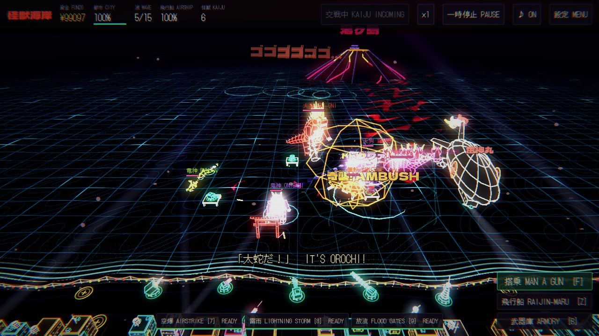
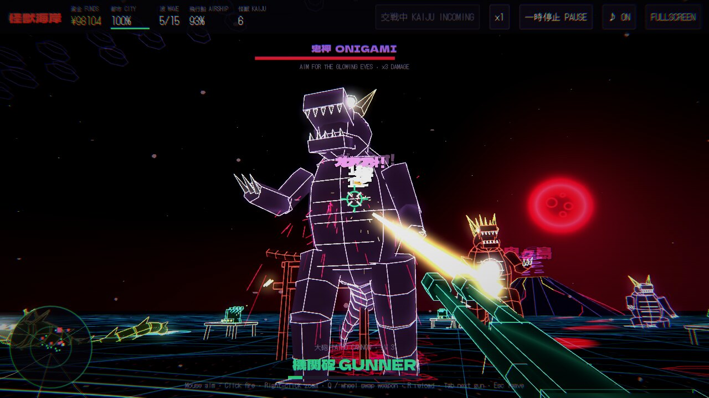
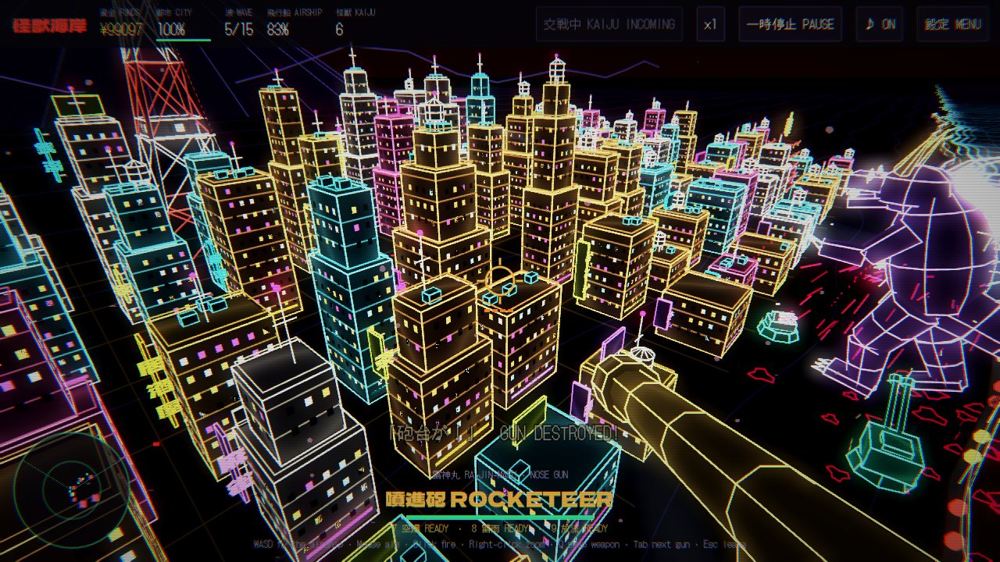
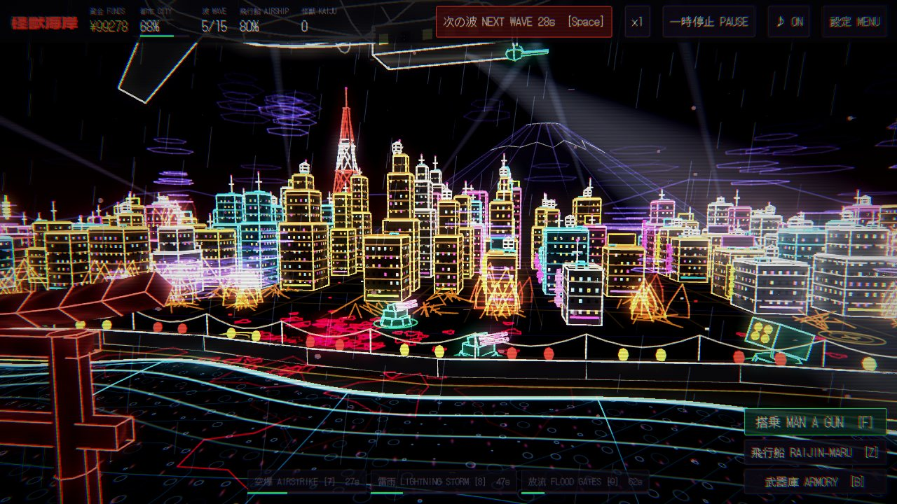
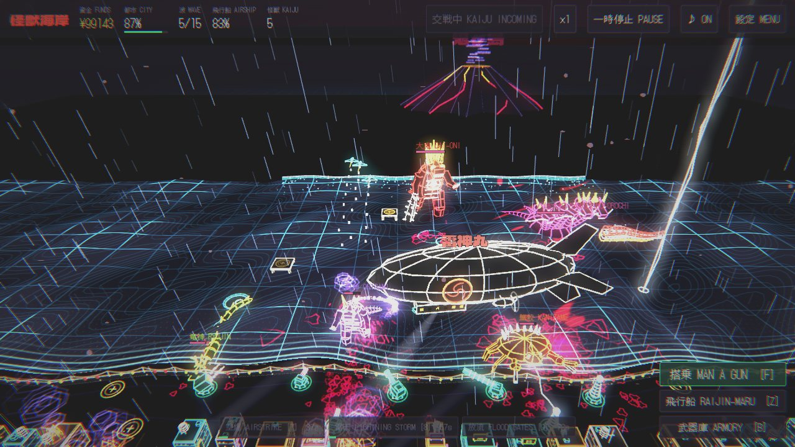
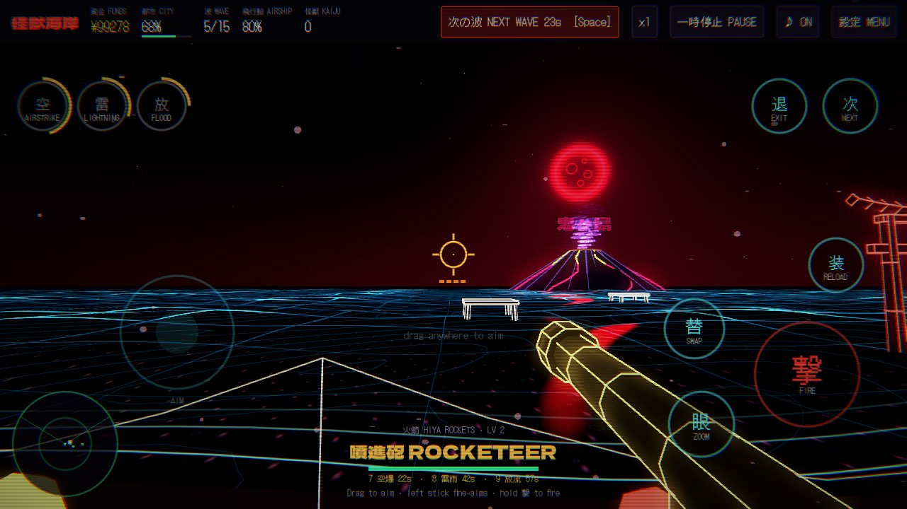

# Kaiju Coast 怪獣海岸



A neon vector tower defence game made in **Godot 4.3**. It's set on a Japanese bay under a blood
moon. Giant kaiju wade in from the volcano island of Oni-ga-shima. Build and upgrade guns along
the seawall and on the sea forts, and fit out the airship **Raijin-maru (雷神丸)**. At any time
you can climb into any gun, or the airship's nose gun, and fight in first person as a **gunner**
or a **rocketeer**. You can even fly the airship yourself.

Everything is a "vector solid", the look of *Rust & Iron*. Each kaiju, gun, building and airship
is a dark filled shape with thick glowing neon edges, bloomed by the renderer, under a CRT
scanline pass. The city has lit windows that switch on and off, setbacks, water tanks, AC units,
antenna beacons, vertical kanji blade signs, rooftop marquees, flickering ad screens, shop fronts
and searchlights on the tallest roofs. Kaiju knock it all down and set it on fire.

<p>


</p>
<p>


</p>

The soundtrack and every sound effect are synthesised in code. The music mixes taiko and
shime-daiko over a pumping four-on-the-floor kick, with shamisen bass, a pentatonic synth arp,
koto melodies and a shakuhachi lead, all in the Japanese *In* scale. It has four loops (title,
calm, battle and boss), rendered on a background thread the first time the game starts and
cached after that. Listen to [`docs/soundtrack-preview.mp3`](docs/soundtrack-preview.mp3) for the
title, battle and boss loops with some of the sound effects over the top. Radio call-outs in
Japanese (出撃! 敵襲来! 大鬼だ! 津波!) come from a small formant speech synthesiser, with
subtitles.

## Download

* **Windows:** open the repository's **Actions** tab, select the latest **Kaiju Coast builds**
  run and download **kaiju-coast-windows** from its *Artifacts*. Unzip it and double-click
  `KaijuCoast.exe`. Windows SmartScreen may warn because the game isn't code-signed: choose
  **More info → Run anyway**.
* **Android:** download **kaiju-coast-apk** from the same run, copy `kaiju-coast.apk` to the phone
  and open it (allow installs from that app when Android asks). Without the release key secrets
  the APK is signed with a throwaway debug key, so uninstall the old one before installing a new
  build.
* **Linux:** **kaiju-coast-linux**.
* **itch.io:** builds go to `gamesdevnisite/kaiju-coast` when you push a tag like `kc-v1.0.0`, or
  run the workflow by hand with *Push the builds to itch.io* ticked. It needs the
  `BUTLER_API_KEY` secret, and the `ANDROID_RELEASE_KEYSTORE_*` secrets for the Android upload
  (the same secrets the other games here use).

Every push that changes `kaiju-coast/` builds fresh Windows, Linux and Android versions. The
workflow is `.github/workflows/kaiju-coast.yml`. It runs the smoke test first and fails if the
game is broken.

## Trailer and itch.io page

`launch/out/kaiju_coast_trailer.mp4` is a 75-second trailer filmed inside the game with Godot's
Movie Maker (`tools/trailer/`), and `launch/itch-page.md` has everything for the itch.io page:
the description in English and Japanese, tags, settings and uploads, with the cover, banner,
screenshots and GIFs in `launch/out/`.

## Open it in Godot

1. Install Godot 4.3 (standard, not .NET).
2. In the Project Manager choose **Import** and pick `kaiju-coast/project.godot`.
3. Press **F5**. The first launch takes a few extra seconds while the music renders in the
   background.

To export it yourself, install the 4.3 export templates (Editor → Manage Export Templates), then
use Project → Export → **Windows Desktop** (or **Android**, which also needs the Android SDK set
up in the editor settings). From the command line:

```
godot --headless --path . --export-release "Windows Desktop" build/windows/KaijuCoast.exe
```

## How to play

* **Click a ring** on the shore or on a sea fort to build a gun there. Click a built gun to
  upgrade, repair, sell or man it. At level 3 each gun takes one of **two upgrade paths**.
* **Start the next wave** with Space or the red button. Calling a wave early earns a bonus.
* **Man a gun (F)** or **board the airship (Z)** to fight in first person. Your damage grows with
  the gun's level. In the airship, **WASD flies it** while you shoot.
* **Shoot out the weak points**: the glowing eyes, the sea dragon's pearl and the Dai-Oni's chest
  core take **triple damage** and break. A kaiju with an eye out staggers and goes berserk; cut
  all of an Orochi head's eyes out and the head comes off.
* **Special attacks** charge up between uses: an **airstrike** (7), a **lightning storm** (8, from
  wave 3) and the **flood gates** (9, from wave 5), which throw a surge back out to sea.
* Kaiju that reach the shore start smashing the city. Hold all **15 waves** to win, then keep
  going in endless mode if you like. Choose **Easy, Normal or Hard** on the title screen.
* The first game starts with a short **tutorial**. The weather changes from wave to wave: rain,
  and on boss waves a storm with lightning and a heavy swell.

| Command view | |
|---|---|
| Click | Select a ring, a gun or the airship |
| Drag, A/D, W/S, mouse wheel | Pan and zoom |
| 1–5 | Build on the selected ring |
| U · R · X | Upgrade · repair · sell the selected gun |
| B | Armory (gunner and rocketeer upgrades, rebuild the city) |
| 7 · 8 · 9 | Airstrike · lightning storm · flood gates (then click the sea) |
| Space · T · P · M | Next wave · game speed · pause · music |
| Esc | Back, or the pause menu (settings live there) |
| F11 or Alt+Enter | Fullscreen |

| First person | |
|---|---|
| Mouse, or arrow keys / right stick | Aim |
| Left click, Space or right trigger | Fire |
| Right click or left trigger | Zoom |
| Q, mouse wheel, or 1 and 2 | Switch between the machine gun and the rocket launcher |
| R | Reload rockets |
| WASD or left stick | Fly the airship (when you're in it) |
| 7 · 8 · 9 | Special attack where the crosshair points |
| Tab / E | Jump to the next gun |
| Esc / F | Back to the command view |

| Controller | Command view | First person |
|---|---|---|
| Left stick | Pan and zoom | Fly the airship |
| Right stick | | Aim |
| A | Select what's in the middle of the screen | |
| LB · RB | Previous · next gun ring (and the airship) | Next gun |
| Y | Man the selected gun | Swap weapon |
| X | Select the airship | Reload |
| B | Deselect | Leave |
| D-pad ← ↑ → | Airstrike · lightning storm · flood gates | |
| Start · Back | Next wave (or pause) · pause | |

**Touch (phones and tablets):** tap a ring to build, drag to pan and pinch to zoom. In first
person, drag anywhere to aim, hold **撃 FIRE**, and use the on-screen buttons to zoom, swap
weapons, reload, call in special attacks, jump to the next gun or leave. The stick on the left
flies the airship.

<p></p>

**Settings** (title screen or pause menu): mouse sensitivity and invert Y, music, effects and voice
volume, graphics quality (Low suits phones and old PCs), fullscreen, the CRT filter, and the
tutorial.

## Guns

| Gun | Targets | Notes | Level 3 paths |
|---|---|---|---|
| 大砲 Taiho Cannon | Ground | Fast shells. Gains barrels as it levels up. | 散弾 six-pellet burst · 徹甲 armour piercing |
| 火箭 Hiya Rockets | Ground + air | Homing salvos with splash damage. | 子爆 cluster bomblets · 群れ bigger swarm |
| 雷神 Raijin Coil | Ground + air | Chain lightning that slows kaiju. Short range. | 嵐 longer chains · 雷 one huge stunning bolt |
| 刀 Katana Rail | Ground | Pierces every kaiju in a line and ignores armour. | 二段 double shot · 急所 sniper (aims for weak points) |
| 花火 Hanabi Flak | Air | Firework air-bursts for the tengu. | 星 huge bursts that also hit wading kaiju · 追尾 homing |

The airship takes its own upgrades: a bomb bay, rocket pods and armour plating. Tengu hunt it.
If it's shot down it falls into the bay and comes back 30 seconds later.

## Kaiju

| Kaiju | |
|---|---|
| 鬼神 Onigami | The horned brute. Breathes a beam that burns down guns. |
| 蟹鮫 Kanizame | Crab-shark. Shrugs off half of all shell and bullet damage, and burrows under the sea forts. |
| 竜神 Ryujin | Sea dragon. Fast, resists lightning, and coils round a sea fort to crush it. |
| 天狗 Tengu | Flying. Goes after the airship, dive-bombs whichever gun you're manning, then the city. |
| 大鬼 Dai-Oni | The wave 5 boss, armed with a spiked kanabo club. |
| 八岐大蛇 Yamata-no-Orochi | The wave 10 boss: five dragon heads on long necks. Cut them off one by one. |

From wave 15 every fifth wave brings both bosses at once.

Kaiju wade round the sea forts (unless they've come for one), shoulder each other aside, and knock
down any block they step into. The torii in the bay doesn't survive a kaiju walking into it: it
stays down until the next game. The airship climbs to clear anything tall standing under it.

## How it's built

All of the game is built in code from `scenes/main.tscn`, which holds a single node.

| Script | What it does |
|---|---|
| `game.gd` (autoload `Game`) | Gun, kaiju and upgrade stats, game state, economy, waves and difficulty |
| `main.gd` | Builds the scene, runs the simulation step, input (mouse, keys, controller) and build actions |
| `world.gd` | Sky, sea, shore, seawall and lanterns, torii, volcano, Fuji, the city and its collapse, fires, searchlights, traffic and the weather |
| `kaiju.gd` | Jointed solid rigs posed every frame, hit spheres and weak points, hit reactions, kaiju AI and specials |
| `turret.gd` · `zeppelin.gd` | The guns and their upgrade paths, the airship and its helm |
| `player.gd` · `camera_rig.gd` | First person, the view model, and the camera's framings |
| `abilities.gd` | Airstrike, lightning storm and flood gates |
| `combat.gd` · `fx.gd` | Shots, hits and damage; sparks, blood, gore, flames, fireworks, beams and floating text |
| `hud.gd` · `touch_controls.gd` | All the 2D UI, menus and the phone controls |
| `settings.gd` · `tutorial.gd` | Saved settings; the guided first wave |
| `solid_builder.gd` · `line_builder.gd` · `frame_lines.gd` · `mats.gd` | Vector-solid meshes, thick screen-space lines and shared materials |
| `synth.gd` · `sfx.gd` · `music.gd` · `voice.gd` · `voice_synth.gd` | The synthesiser, 3D sound effects, the soundtrack and the voices |

The renderer is **Compatibility** (OpenGL 3.3 / OpenGL ES 3), so it runs on almost any Windows PC
and on Android phones. Lines are drawn as screen-space quads (`shaders/thick_line.gdshaderinc`),
so they stay thick at any resolution; the rain is one mesh that wraps round the camera in its
shader.

## Tests

```
godot --headless --path . res://tests/smoke_test.tscn      # exit code 0 = all pass
godot --path . res://tests/showcase.tscn -- --out=/tmp/shots   # renders the screenshots above
godot --headless --path . res://tests/audio_preview.tscn -- --out=/tmp/audio   # music, effects and voice lines as WAV
```

The smoke test plays real waves without rendering. It builds and upgrades guns, mans a gun
mid-wave, fights the wave 5 boss and checks the city can fall. It also covers weak points,
upgrade paths, every kaiju special, the Orochi, flying the airship, the special attacks, the
voices, the weather, fires, searchlights, kaiju knocking down the torii and keeping clear of the
sea forts and each other, shots leaving from the barrels you can see, the touch controls, difficulty, the tutorial, the pause
and settings menus and the controller. Run the game with `-- --touch` to see the touch controls on
a PC. Under `--headless`, Godot prints `Parameter "m" is null … mesh_get_surface_count` many
times. That's harmless noise from its dummy renderer.

## Web prototype

`web/index.html` is the first version of the game: a single HTML page with its own canvas
wireframe renderer. It's kept for reference, and Godot ignores it.

## Credits

Design, code, art, music and sound: made for this repository, all generated in code. The speech
synthesiser is shared with Neon Mega Tank in this repository.
Fonts: [Dela Gothic One](https://fonts.google.com/specimen/Dela+Gothic+One) and
[DotGothic16](https://fonts.google.com/specimen/DotGothic16), both under the SIL Open Font
License (`fonts/OFL-*.txt`).
