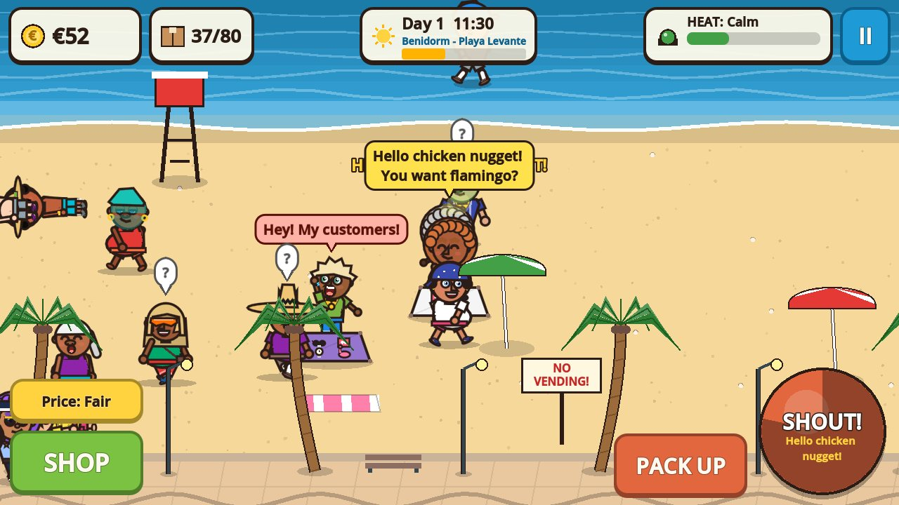
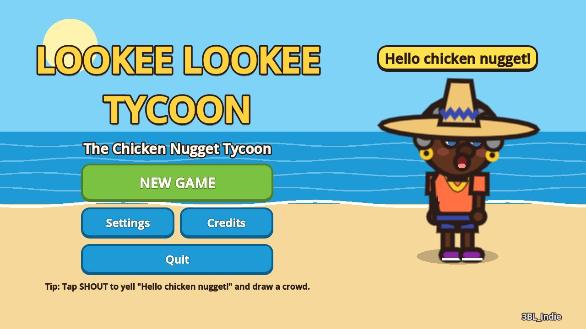
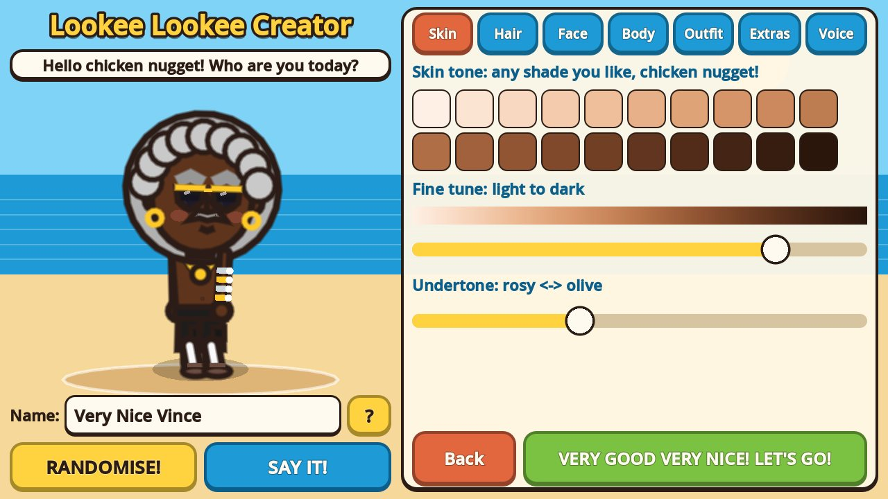
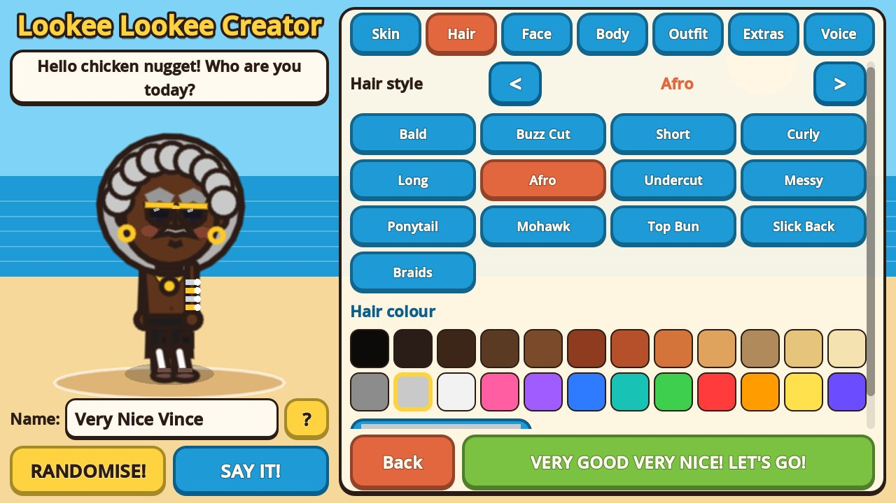
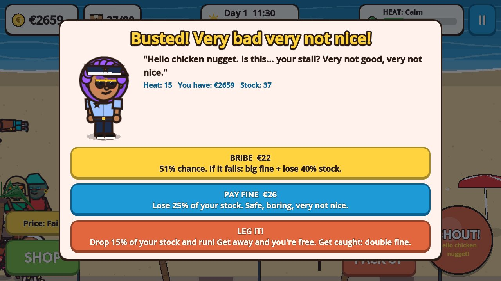
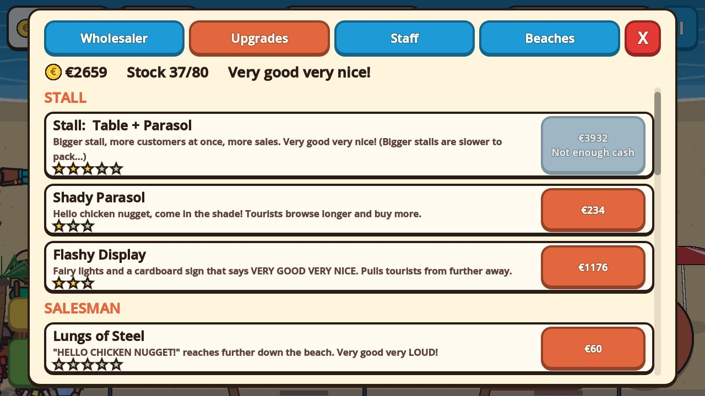
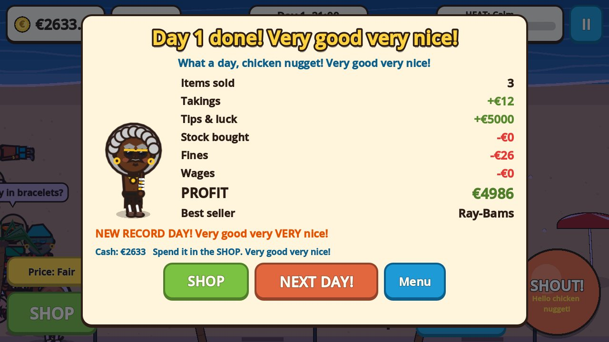

# Lookee Lookee Tycoon

*(also known as **Chicken Nugget Tycoon**)*



**Hello chicken nugget!** You're a chaotic beach vendor on the Spanish Costa. Buy the
cheapest plastic junk money can buy, shout *"Hello chicken nugget!"* at sunburnt tourists, sell
it with a *"Very good very nice!"*, pack up the blanket before the Policía Local arrive, hire
your own crew, and grow one blanket on the sand into an empire spanning six resorts.

A 2D tycoon for **Android** (touch first) and the **browser** (itch.io), made in **Godot 4.3**.
Every sprite, sound, voice line and music track is generated in code. The game's data pack is
about **350 KB**. The rest of every build is the Godot engine: for the web, a 35 MB `.wasm` that
gzips to about 8 MB.

<p>






</p>

## How to play

| | Phone / tablet | Mouse | Keyboard |
|---|---|---|---|
| Walk somewhere | tap the sand | click | |
| Pitch to a tourist | tap them | click them | |
| Look around | drag | drag | |
| Zoom | pinch | scroll wheel | |
| Shout "Hello chicken nugget!" | **SHOUT** button | **SHOUT** button | Space / S |
| Set up / pack up the stall | **SET UP / PACK UP** | same | E / P |
| Shop (stock, upgrades, staff, beaches) | **SHOP** | same | B / Tab |
| Change your prices | **Price** button | same | M |
| Pause | **II** or the Back button | same | Esc |

1. **Set up** your blanket on the sand, then **SHOUT**. Tourists who hear you get curious, and
   when they're curious enough they come over to browse. Some buy, some say no, and some haggle
   (tap **DEAL!** or **NO**).
2. Every sale and every shout raises the **Heat** meter. When a cop on the promenade spots your
   stall they stop and stare for a few seconds. That's your chance to **PACK UP**. Bigger
   stalls sell more but take longer to pack.
3. If they reach an open stall you're **busted**. You can **bribe** them (it might work), **pay
   the fine** and lose some stock, or **LEG IT!**: drop some stock and run. Tap where to run;
   get far enough away, or last long enough, and you're free.
4. At 21:00 the day ends. You pay your crew, collect income from your other beaches, and the
   game autosaves. Spend the money in the **SHOP**, then do it all again.

## Features

* **Full Character Creator** (new game, or **Pause > Edit My Vendor** at any time).
  * Skin tone from a continuous gradient running from very light to very dark: 20 swatches, a
    fine-tune slider and a rosy/olive undertone slider. There are no presets tied to ethnicity.
  * 13 hair styles: bald, buzz cut, short, curly, long, afro, undercut, messy, ponytail,
    mohawk, top bun, slick back and braids. Pick from 24 hair colours or use a custom colour
    picker.
  * Faces: 6 eye styles plus eye colour, 6 eyebrow styles, 5 noses, 6 mouths (including the gold
    tooth) and 7 facial hair options.
  * Body type: slim, average, large or muscular.
  * Outfit: 7 shirts, 6 shorts and trousers, 5 kinds of shoes (yes, socks and sandals), each in
    18 colours.
  * Accessories: 7 hats, 5 sunglasses, chains, watches (including the legendary arm full of
    watches), earrings and bags.
  * Voice pitch, applied to every "Hello chicken nugget!" and "Very good very nice!".
  * Live preview, a **RANDOMISE!** button, a **SAY IT!** button, and a name.
* **Tourists** in 7 types (Sunburnt Brits, Stag & Hen Parties, Families, Pensioners,
  Influencers, Backpackers and Yacht Folk) with 5 moods. Each type has its own budget, taste in
  junk and patience, plus a habit of complaining to the police.
* **Police** patrol the promenade. The **Heat** meter has four levels (Calm, Suspicious, Wanted,
  RAID!), and a bust ends in a bribe, a fine or a chase.
* **18 items of junk**, from fridge magnets to Louis Vuitpoint bags, across 5 supplier tiers.
  Use the price setting to go from Bargain to Daylight Robbery.
* **16 upgrades in 5 categories.** The stall grows from a blanket to a fold-out table, a big
  table, a table with parasol, a deluxe gazebo and finally a pop-up kiosk. Other upgrades
  include Lungs of Steel, Megaphone, Rope-pull Blanket, Charm School, Cousin in the Policía,
  Rusty Van and Business Cards.
* **Staff.** Hire Blanket Sellers, Shouters, Lookouts (they ask the police for directions) and
  Runners. Each one has a random look, a skill rating and a wage.
* **Six Costa beaches**: Benidorm, Torremolinos, Salou, Lloret de Mar, Magaluf and Marbella.
  Each has its own crowd, wealth, police strictness and colours. Buy kiosks for passive income.
* **13 random events**: cruise ship, rain, police crackdown, heatwave, football final, fiesta,
  going viral, supplier sale, a rival vendor (shout to scare them off), a seagull thief, a lost
  wallet, a hotel complaint and a coach party.
* **A day clock** from 09:00 to 21:00 that tints the beach from morning light to sunset. The
  crowd follows the time of day.
* **Save/load**: autosaves at the end of each day, when you pause, and when the app goes to the
  background.

## Project structure

```
lookee-lookee-tycoon/
├── project.godot            Autoloads, 1280x720 landscape, GL Compatibility renderer
├── export_presets.cfg       Android, Web (itch.io), Windows, Linux
├── autoload/                Global systems (singletons)
│   ├── game_manager.gd      Scene flow, day clock, empire, pause, Back button, toasts
│   ├── character_data.gd    The player's look; emits appearance_changed
│   ├── economy.gd           Cash, stock, prices, sale odds, fines, daily stats
│   ├── heat_system.gd       Police attention 0-100 and its four levels
│   ├── upgrades.gd          Upgrade tree + every gameplay stat derived from it
│   ├── staff.gd             Hiring, wages, off-site income
│   ├── random_events.gd     Event timer, modifiers read by gameplay
│   ├── save_system.gd       JSON save (+ localStorage mirror on the web), settings
│   ├── audio_manager.gd     SFX/voice/music players; synthesis queue; OGG overrides
│   └── quality.gd           Device tier detection, 60/30 FPS fallback, keep screen on
├── data/                    Pure data, easy to edit
│   ├── lines.gd             ALL flavour text: sales lines, police, events, tips, creator
│   ├── items.gd             The junk catalogue
│   ├── tourist_types.gd     Tourist archetypes and moods
│   └── beaches.gd           The six resorts
├── scripts/
│   ├── character/
│   │   ├── vendor_avatar.gd       Modular cut-out character rig (everyone uses it)
│   │   └── appearance_options.gd  Option lists, palettes, skin gradient, randomiser
│   ├── beach/               Gameplay: beach.gd (referee), vendor, stall, tourist,
│   │                        tourist_pool (object pool), police, worker, camera_rig
│   │                        (touch input), backdrop, props, fx_layer (pooled particles),
│   │                        speech_bubble, walker (shared base)
│   ├── ui/                  main_menu, character_creator, hud, shop_menu, pause_menu,
│   │                        settings_panel, busted_dialog, day_summary, overlay (base),
│   │                        widgets (avatar view, item icon, round button)
│   ├── art/                 ui_theme.gd (theme + widget helpers), item_art.gd (icons)
│   └── audio/               voice_synth.gd (formant speech), sfx_synth.gd, music_synth.gd
├── scenes/                  main_menu, character_creator, beach, ui/{hud,shop_menu,pause_menu}
├── studio/                  3BL_Indie splash and credits (shared by every 3BL_Indie game)
├── art/characters/, art/items/   Drop-in PNG overrides (see docs/ART_GUIDE.md)
├── audio/voice/, audio/sfx/, audio/music/   Drop-in OGG overrides
├── icons/                   App icons (generated by tools/make_icons.gd)
├── itch/                    Store page text and cover image
├── tests/smoke_test.*       Plays the whole game headless; exit code 0 = pass
└── tools/                   Screenshot tool, icon generator, itch build script
```

### How the systems talk

Everything communicates with **signals**, and gameplay code never pokes at UI directly:

* `Economy.cash_changed`, `stock_changed`, `sale_made` and `markup_changed` drive the HUD and
  stall displays.
* `HeatSystem.heat_changed` and `level_changed` drive the meter, police dispatch and sirens.
* `GameManager.day_started`, `day_ended`, `time_changed` and `toast` drive the clock, day
  summary and notifications. `back_pressed` carries the Android back button and Esc.
* `RandomEvents.event_started` and `event_ended` drive banners, rain, the cruise ship and the
  rival.
* `CharacterData.appearance_changed` makes every avatar that follows the player redraw at once.
* `Upgrades.upgrade_purchased` and `Staff.staff_changed` refresh the shop and the stall.

Balance lives in one place. Gameplay asks `Upgrades` for stats (`shout_radius()`,
`pack_time()`, `stall_slots()`...), and `Economy.sale_chance()` decides every sale.

### The Character Creator: saving and applying the look

1. An appearance is a plain `Dictionary` (option indices, HTML colour strings, voice pitch,
   name), so it saves straight to JSON. `AppearanceOptions.sanitize()` validates every load,
   which keeps old or hand-edited saves safe.
2. The creator edits a working copy and shows it live in a `Widgets.AvatarView`. **Confirm**
   calls `CharacterData.set_appearance()`, which emits `appearance_changed`, and then
   `SaveSystem.save_game()`.
3. Every `VendorAvatar` with `follow_character_data = true` re-reads the look on that signal:
   the vendor on the beach, the menu preview, the pause menu and the day summary. Your voice
   pitch is applied whenever `AudioManager.say()` speaks for the player.
4. Tourists, police and workers use the same rig with random or uniform appearances, so the art
   is consistent everywhere.

## Catchphrases: where the text lives

Everything the game says lives in [`data/lines.gd`](data/lines.gd); item descriptions are in
`data/items.gd`, upgrade text in `autoload/upgrades.gd` and event text in
`autoload/random_events.gd`. Some examples:

* **Sales:** "{item}! Very good very nice!", "Only {price}! Very good very nice!", "Very good
  very nice! You look like film star!"
* **Pitches:** "Hello chicken nugget! Special price for you: {item}!"
* **Upgrades:** Lungs of Steel: *"HELLO CHICKEN NUGGET!" reaches further down the beach. Very
  good very LOUD!* Rope-pull Blanket: *The classic! Pull the strings, the shop disappears.*
* **Events:** Cruise Ship: *3,000 tourists with money! Hello chicken nugget, hello chicken
  nuggets!* Supplier Sale: *Cousin Pepe has too many boxes... Very good very cheap!*
* **Items:** Rolax Watch: *Swiss quality! (Swiss is a small town near the motorway.)*

The tone is silly and satirical but never mean. The jokes land on the junk, the tourists'
holiday habits and the absurdity of the hustle, never on who anyone is. Please keep it that way
when adding lines.

## Android optimisations (and where they live)

| Requirement | Implementation |
|---|---|
| Pure 2D | `Node2D` + `Control` only. The **GL Compatibility** renderer is used on every platform. |
| 60 FPS, graceful 30 fallback | `autoload/quality.gd` samples FPS on the beach. Below 48 it drops a quality tier; below 40 it caps at 30 FPS. |
| Auto quality detection | `Quality.detect()`: phones with 4 cores or fewer get Low, other phones and browsers get Medium, desktops get High. Settings can override it. |
| Object pooling | `TouristPool` (tourists are reused, never freed), `FxLayer` (all coins, puffs and floating text drawn by one node from a fixed array), pooled audio players. |
| Tourist cap | 16 / 24 / 30 by tier (`Quality.MAX_TOURISTS`). |
| Cheap characters | Body parts redraw only when the look changes; animation just transforms parts. Off-screen avatars stop animating (`VisibleOnScreenNotifier2D`). Waves redraw at 20 FPS. |
| Compressed textures | `import_etc2_astc=true`. Any PNG art you add is imported as ETC2/ASTC for Android and S3TC/BPTC for desktop browsers. |
| OGG audio | All audio is synthesised at runtime (no files). Drop-in overrides are loaded as OGG. |
| Touch controls | Big buttons (68-190 px), tap to walk or pitch, drag to pan, pinch to zoom (`camera_rig.gd`). Emulated mouse events are ignored, so nothing triggers twice. |
| Back button → pause | `quit_on_go_back=false`. `GameManager` turns `NOTIFICATION_WM_GO_BACK_REQUEST` into `back_pressed`: on the beach it opens the pause menu, and in menus it closes the top overlay. On the main menu, Back quits. |
| Immersive mode | `screen/immersive_mode=true` in the Android preset. Landscape is locked (`sensor landscape`). |
| Keep screen on, notches | `Quality` calls `screen_set_keep_on(true)`. `UITheme.safe_margins()` keeps UI clear of display cutouts. |
| Saves when backgrounded | `NOTIFICATION_APPLICATION_PAUSED` / `FOCUS_OUT` triggers a save and opens the pause menu. |
| Download size | The game data is about 350 KB, far under the 100 MB target; the APK is almost entirely the Godot engine's native libraries. It ships arm64 + armv7: untick armeabi-v7a in the preset to drop one copy of the engine if you only target modern phones. |

## Exporting for Android

You need Godot **4.3** (standard build), the **4.3 export templates** (in Godot: *Editor >
Manage Export Templates > Download and Install*), **JDK 17** and the **Android SDK** (the
easiest route is installing Android Studio, or just the command-line tools with
`platform-tools`, `build-tools;34.0.0` and `platforms;android-34`).

1. In Godot, open *Editor > Editor Settings > Export > Android* and set **Java SDK Path** and
   **Android SDK Path**.
2. Make a release keystore once, and keep it safe: Android only installs updates signed with
   the same key.
   ```bash
   keytool -genkeypair -v -keystore lookee-release.keystore -alias lookee \
     -keyalg RSA -keysize 2048 -validity 10000
   ```
3. Open *Project > Export*, pick **Android**, and under *Keystore > Release* enter the keystore
   path, `lookee` and your password. (Godot fills in a debug keystore automatically for test
   builds.)
4. Click **Export Project** and untick *Export With Debug*. You get
   `build/android/LookeeLookeeTycoon.apk`.
5. Install it with `adb install -r build/android/LookeeLookeeTycoon.apk`, or copy it to a phone
   and open it.

From the command line, with the keystore given through environment variables:

```bash
GODOT_ANDROID_KEYSTORE_RELEASE_PATH=/path/lookee-release.keystore \
GODOT_ANDROID_KEYSTORE_RELEASE_USER=lookee \
GODOT_ANDROID_KEYSTORE_RELEASE_PASSWORD=... \
godot --headless --path . --export-release Android build/android/LookeeLookeeTycoon.apk
```

For the **Google Play Store**, which wants an `.aab`, tick *Use Gradle Build* in the preset,
install the Android build template (*Project > Install Android Build Template*), set
*Export Format* to AAB, and raise `version/code` for every upload.

**GitHub Actions:** `.github/workflows/lookee-lookee-tycoon.yml` runs the smoke test and
builds the APK, web, Windows and Linux versions on every push that touches this folder.
Download them from the run's *Artifacts*. Add the `LOOKEE_ANDROID_KEYSTORE_*` secrets (see the
top of the workflow) for a release-signed APK, and `BUTLER_API_KEY` to push to itch.io.

## Exporting for the browser (itch.io)

The **Web** preset is set up for itch.io: no thread support, so no special server headers are
needed; the canvas resizes to fit; touch works, and text input uses the virtual keyboard. Saves
go to IndexedDB (`user://`) and are mirrored to `localStorage`.

1. Install the 4.3 export templates (as above).
2. Open *Project > Export > Web > Export Project* and save as `build/web/index.html`, or run:
   ```bash
   godot --headless --path . --export-release Web build/web/index.html
   ```
3. Zip the **contents** of `build/web`, so that `index.html` sits at the top of the zip:
   ```bash
   cd build/web && zip -r ../lookee-lookee-tycoon-web.zip . && cd -
   ```
   `tools/itch/build_itch.sh` does steps 2-3 for every platform at once.
4. On itch.io, create a new project:
   * *Kind of project*: **HTML**. Upload the zip and tick **This file will be played in the
     browser**.
   * *Embed options*: viewport **1280 × 720**, tick **Mobile friendly** (orientation:
     **Landscape**), **Automatically start on page load** and **Fullscreen button**.
     **SharedArrayBuffer support** is *not* needed.
   * Use `itch/cover.png` as the cover image and `itch/PAGE.md` for the description.
5. Upload the Android APK (and Windows/Linux zips) to the same page as downloadable files.

To test locally, run `python3 -m http.server -d build/web 8000` and open
<http://localhost:8000>. Opening the file directly won't work.

## Testing

```bash
# Plays the whole loop at 4x speed: creator, a day of selling, every event, shop, busts
# (fine / leg it / bribe), staff, day end, travel, save/load. Exit code 0 = pass.
godot --headless --path . res://tests/smoke_test.tscn

# Screenshots of every screen (needs a display; use xvfb-run on a server).
godot --path . res://tools/screenshots.tscn -- /tmp/screens

# Regenerate the app icons and itch cover from the character rig.
godot --path . res://tools/make_icons.tscn
```

## Art and audio

All art is drawn procedurally, and every part can be replaced by a PNG without touching code.
**[docs/ART_GUIDE.md](docs/ART_GUIDE.md)** explains the modular character layers, anchor points,
greyscale tinting for skin, hair and clothes, item icons and import settings.

To replace the synthesised voice with a real recording, drop
`audio/voice/hello_chicken_nugget.ogg` and `audio/voice/very_good_very_nice.ogg` into the
project. The player's voice-pitch slider still applies. Sound effects (`audio/sfx/<name>.ogg`)
and music (`audio/music/beach.ogg`, `chase.ogg`) work the same way. See `AudioManager` for the
names.

## Extending

* **New junk:** add an entry to `ItemDB.ITEMS`. It appears in the Wholesaler, on stalls and in
  tourists' wish lists.
* **New upgrade:** add it to `Upgrades.DEFS`, then read its level in a stat helper.
* **New event:** add it to `RandomEvents.EVENTS` with `mods` (multipliers like `spawn`,
  `heat_gain`, `budget`) or handle its id in `beach.gd`'s `_on_event_started`.
* **New beach:** add it to `BeachDB.BEACHES` and `BeachDB.ORDER`.
* **New hair style / hat / shirt:** append its name in `AppearanceOptions`, then add a `match`
  branch in the matching `VendorAvatar` painter, or just drop in a PNG.
* **New tourist type:** add it to `TouristTypes.TYPES`, give it an appeal in every item, and
  add it to beaches' `mix`.

## Credits

**Lookee Lookee Tycoon**, a 3BL_Indie game. Made with Godot Engine (godotengine.org/license).
See [CREDITS.md](CREDITS.md).
