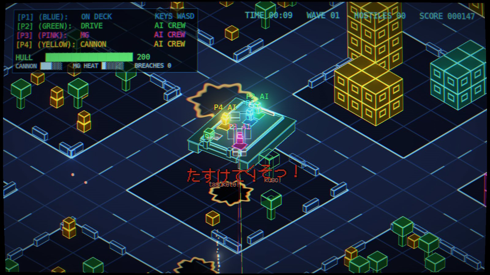
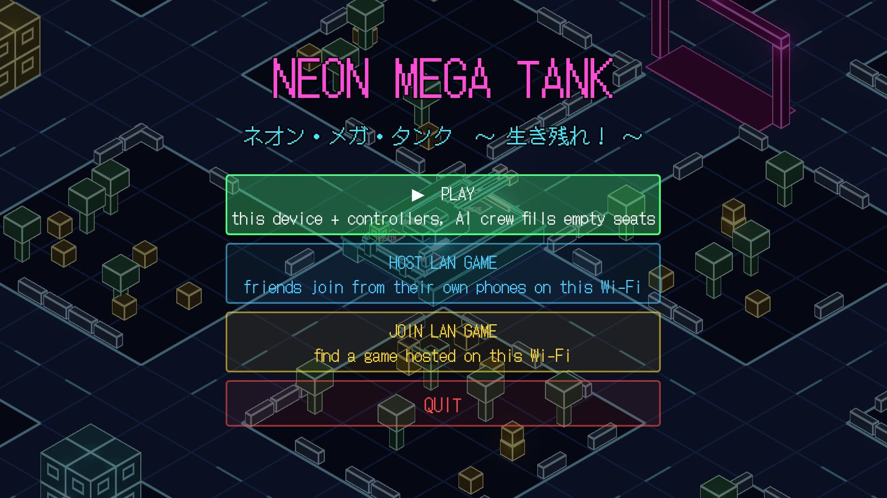
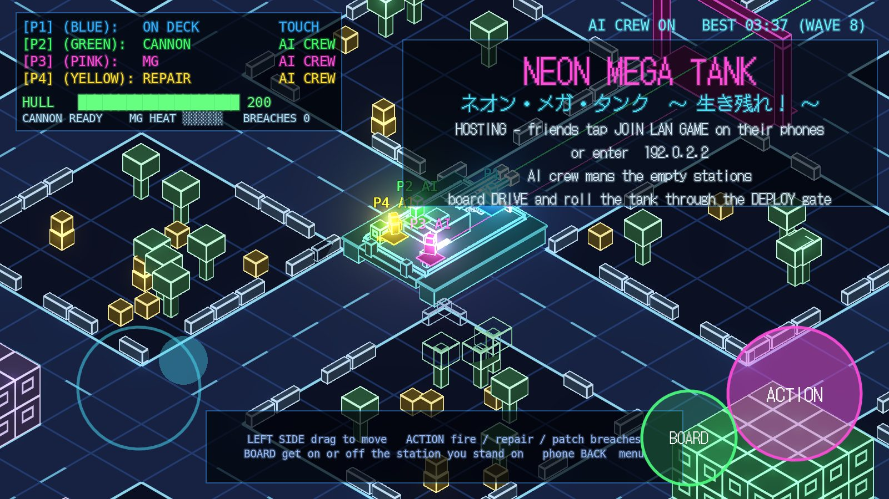

# Neon Mega Tank



Co-op for 1–4 players, made in **Godot 4.3**. The whole crew shares one giant neon tank.
Like *Lovers in a Dangerous Spacetime*, every crew member runs around the open deck and jumps
between stations. It's an endless survival game: how long can you last against escalating waves
of infantry, RPG troopers, drones, kamikaze buggies, enemy tanks and the 鬼戦車 *Oni Sensha* boss?
Each run takes place in a newly generated neon city where every building, barrier, crate and
tree can be destroyed.

Play it three ways:

* **On phones over Wi-Fi.** One phone hosts and friends join from their own phones on the same
  network. Everyone plays with on-screen controls and watches the battle on their own screen.
* **Couch co-op on a PC.** Two keyboard halves plus up to four gamepads share one screen.
* **Solo.** **AI crew** members fill every empty seat, and a friend who joins takes over a bot's
  body on the spot.

The game has an anime-style **chiptune soundtrack**, and defeated enemies shout in Japanese in
**robotic electronic voices** with manga-style subtitles. All music, voices and sound effects are
synthesised in code, so the project ships no audio files. Listen to
[`docs/audio-preview.mp3`](docs/audio-preview.mp3) for the lobby theme, the battle theme, the
game-over sting, the main sound effects and every voice line.

<p>


</p>

## Play on Android phones

1. **Get the APK.** Every push that changes this folder builds one automatically: open the
   repository's **Actions** tab, select the latest **Neon Mega Tank APK** run, and download
   `neon-mega-tank-apk` from its *Artifacts* section. You can also export it yourself (see below).
2. **Install it on every phone.** Copy the `.apk` to the phone and open it. Android will ask you
   to allow installs from that app (Files, Chrome or your messenger) the first time.
3. **Put every phone on the same Wi-Fi.**
4. **One player taps HOST LAN GAME.** The lobby shows the host phone's IP address.
5. **Everyone else taps JOIN LAN GAME.** The host appears in the list within a second or two; tap
   it. If it doesn't appear, type the IP address shown on the host's screen and tap CONNECT.
6. **Start the game.** Whoever boards DRIVE rolls the tank through the pink DEPLOY gate.

Each phone gets its own crew member and its own view of the battle. Empty seats are taken by
the AI crew, and if a phone disconnects, a bot takes over its seat. A host can also have
gamepads or keyboards connected; those players join the same crew.

**Touch controls:** drag anywhere on the left half of the screen to move or aim. **BOARD** gets
on or off the station you're standing on, and **ACTION** fires, repairs or patches breaches.
The phone's back gesture returns to the lobby or the menu.

**If phones can't find each other:** some guest, hotel and school networks block devices from
talking to each other ("client isolation"). Use a home router or one phone's mobile hotspot
instead. The game uses UDP ports 47470 (game) and 47471 (discovery).

## Run it on a PC

1. Install [Godot 4.3+](https://godotengine.org/download) (standard build, no .NET needed).
2. In the Project Manager, choose **Import** and pick `neon-mega-tank/project.godot`.
3. Press **F5** to play. PC players can host or join LAN games with phones too.

Add `-- --touch` to the launch arguments to try the phone interface on a desktop.

## How to play

* **Join:** press ACTION on any free device (two keyboard halves plus up to four gamepads).
  Players can also drop in mid-game. On a phone you join automatically.
* **AI crew:** once one player has joined, bots take the empty seats. In the lobby they man the
  guns and leave DRIVE to you. In battle they drive, aim, shoot down rockets, patch breaches and
  repair. To take a bot's station, stand on it and press INTERACT (BOARD on a phone). F2 or the
  gamepad BACK button turns the AI crew on or off.
* **Deploy:** board DRIVE and roll the tank through the pink **DEPLOY** gate. You can practise
  shooting buildings before you deploy.

| Station | Stick | ACTION |
|---|---|---|
| **DRIVE** | Tank turns to face the stick, then drives. Point it backwards to reverse. | – |
| **CANNON** | Aims the twin-barrel turret. The turret holds its aim while the tank turns. | Fire explosive shells that blow apart terrain |
| **MG** | Aims the machine gun | Hold to fire. Overheats. Can shoot RPG rockets out of the air |
| **REPAIR** | – | Hold to repair the hull |

**Breaches:** heavy hits punch burning holes into the deck. Each breach drains the hull, and a
breach next to a station **jams** it. Walk to the breach and hold ACTION to patch it.

**Ramming:** the tank crushes infantry, barriers, crates and trees, and slowly bulldozes
buildings. Ramming a kamikaze buggy sets it off, though.

**Destruction:** buildings are stacks of cubes. Knock out a lower cube and everything above
it collapses.

### Enemies

| Enemy | From wave (full crew) | What it does |
|---|---|---|
| Rifle infantry | 1 | Bursts of rifle fire; crushed by the tank |
| RPG trooper | 2 | Shows a red laser for a second, then fires a rocket the MG can shoot down |
| Enemy tank | 4 | Stops at range, shows a laser and fires shells |
| Drone | 4 | Flies over buildings and strafes the tank. Shoot at its glowing shadow on the ground |
| Kamikaze buggy | 5 | Races in with a beeping light and blows up next to the tank. Shoot it early |
| Heavy tank | 7 | Slower, much tougher, fires three-shell salvos |
| 鬼戦車 Oni Sensha (boss) | every 5th wave | Twin cannon salvos, two MG turrets, launches drones, bulldozes buildings. It has its own health bar |

**Survival:** the clock runs from deployment until the tank dies. Waves grow and enemy health
and damage rise over time. Clearing a wave patches the hull by 40. If a wave drags on,
reinforcements arrive anyway (except during a boss fight). Your best time, wave and score are
saved on each device. In testing, three AI crew with an idle fourth player lasted about
2½–3½ minutes and took the first boss to between 3% and 32% health, so there's a time to beat.

### Controls

| Device | Move | Board/leave (INTERACT) | ACTION |
|---|---|---|---|
| Phone | Drag on the left half | BOARD button | ACTION button |
| Keyboard 1 | WASD | E | Space |
| Keyboard 2 | Arrow keys | Shift or `/` | Enter |
| Gamepad | Left stick / D-pad | B, X or Y | A, RB or RT |

F1 toggles the CRT filter (off by default on phones), F2 or gamepad BACK toggles the AI crew, M
toggles music, F11 toggles fullscreen, and ESC (or the phone's back gesture) goes back from a
game to the lobby and from the lobby to the menu.

## Build the APK yourself

The workflow in `.github/workflows/neon-mega-tank-apk.yml` does this on every push. To do it by
hand:

1. In Godot, open **Editor → Manage Export Templates** and download the 4.3 templates.
2. In **Editor → Editor Settings → Export → Android**, set the Android SDK path (from Android
   Studio or the command-line tools) and a debug keystore. Godot can create the keystore for you.
3. Open **Project → Export**, select the **Android** preset and click **Export Project**.

APKs built by CI use a new throwaway debug key on each run, so you must uninstall the old
version before installing a newer build. To keep one key, add a base64-encoded debug keystore
(alias `androiddebugkey`, password `android`) as the `ANDROID_DEBUG_KEYSTORE_BASE64` repository
secret. To publish on the Play Store, set up a release keystore and use **Export Release**.

## Trailer

`tools/trailer/` films the trailer inside the game. `record.sh` runs `director.gd` once per
shot with Godot's Movie Maker (scripted crew, enemies and camera moves), and `assemble.py` cuts
the takes together with neon title cards, the lobby and battle themes and the announcer:

```
xvfb-run -a -s "-screen 0 1920x1080x24" tools/trailer/record.sh   # or just ./record.sh on a desktop
python3 tools/trailer/assemble.py   # -> tools/trailer/out/neon_mega_tank_trailer.mp4 and a poster
```

## How it works

```
scenes/main.tscn          single entry scene; everything else is built in code
scripts/game.gd           autoload "G": constants, neon mesh helpers, effects, sound, records
scripts/net/net.gd        autoload "Net": LAN hosting/joining, discovery, snapshots, events
scripts/main.gd           game flow: menu, joining, lobby gate, waves, camera, replication
scripts/player_input.gd   per-device input (shared keyboard + gamepads, no InputMap)
scripts/sfx_bank.gd       layered sound effects synthesised at startup
scripts/audio/            chiptune composer, Japanese formant voice synth, voice lines
scripts/tank/             mega tank + stations, crew members, AI crew (bot_input.gd), breaches
scripts/enemies/          soldiers, enemy and heavy tanks, drones, buggies, the boss
scripts/world/            seeded procedural city and destructible blocks
scripts/combat/           projectiles (shells, bullets, rockets)
scripts/ui/               HUD, title menu, touch controls
shaders/                  neon wireframe (+ MultiMesh variant), ground grid, FX, CRT
fonts/                    DotGothic16 pixel font for the Japanese text (SIL OFL, see OFL.txt)
docs/                     screenshots and audio preview (ignored by Godot)
```

### LAN multiplayer

The host runs the whole simulation. Each joining phone sends its stick and buttons to the host
30 times a second. Button presses are sent as counters, so a lost packet never loses a press.
The host sends back a snapshot 20 times a second with the tank, crew, breaches, enemies and
score. Separate events carry anything that happens once: destroyed blocks, explosions,
projectiles, sounds, voices and banners. The city is generated from a seed that the host
shares, so only the destruction travels over the network, and a phone that joins mid-round
receives the list of blocks already destroyed. Hosts announce themselves with a UDP broadcast
every second, which is how the JOIN screen finds them.

### Music and voices

`Chiptune` composes each song from a fixed seed and renders it once into a looping
`AudioStreamWAV`. It plays a pulse-wave lead with vibrato, 16th-note arpeggios, a triangle bass
and noise drums.

* **Battle theme:** built on the J-pop "royal road" chord progression (IV–V–iii–vi), plus the
  "Komuro" progression (vi–IV–V–I), at 160 BPM.
* **Lobby theme:** koto-style plucks in the Japanese *In* scale over a half-step bass.

`VoiceSynth` is a small Klatt-style formant speech synthesiser. A glottal pulse runs through a
cascade of five resonators, and each syllable glides in from its consonant's "locus", which is
how ears tell k from t from p. A light bit-crush then makes it an electronic voice. Its
clarity was tuned against an offline Japanese speech recogniser. The lines are in
`scripts/audio/voice_lines.gd`: やられた！ (I'm hit!), たすけて！ (help me!), おかあさーん！ (mum!),
脱出！ (bail out!), and more. An announcer calls 出撃！ (sortie!), 敵襲来！ (enemy attack!) and
ボス出現！ (boss incoming!). All audio is generated on a worker thread at startup.

The project folder has its own `.gitattributes` that keeps its font, images and audio out of
Git LFS, so a plain clone or GitHub ZIP download runs as-is.

### The neon look

Everything is made of `BoxMesh` cubes with a shader that draws the face edges as glowing lines
of constant pixel width over a near-black fill; the glow comes from `WorldEnvironment`. The city
is drawn with one MultiMesh per city block, so its roughly 2,000 destructible cubes render as
a few dozen batches instead of 2,000 separate objects, which matters on phone GPUs. Buildings between the camera and the tank turn into pure
wireframe, so the tank never disappears behind them.

### Tuning

Most balance numbers are constants at the top of each script. Examples are `MegaTank.MAX_HP`,
`CANNON_RELOAD`, `REPAIR_RATE` and `BREACH_DRAIN`. Wave size and difficulty growth are set in
`Main._start_wave()`, projectile damage in `Projectile.KINDS`, and AI crew priorities in
`Main._assign_bots()`.
