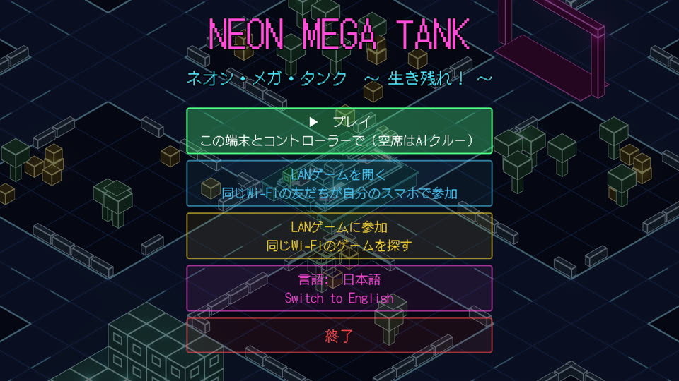

# Neon Mega Tank


Co-op for 1–4 players, made in **Godot 4.3**. The whole crew shares one giant neon tank.
Like *Lovers in a Dangerous Spacetime*, every crew member runs around the open deck and jumps
between stations. It's an endless survival game: how long can you last against escalating waves
of infantry, RPG troopers, drones, hornet swarms, mortar teams, barrier trucks, gunships,
kamikaze buggies, enemy tanks and the 鬼戦車 *Oni Sensha* boss? Each run takes place in a newly
generated neon city where every building, barrier, crate and tree can be destroyed, and whole
buildings come crashing down.

**New in 1.1:** a snappier cannon with aim assist and a landing reticle, a timing mini-game and
an energy shield on the REPAIR station, four new enemies and themed waves, buildings that
collapse into tumbling rubble, and a free demo build with 10 minutes of battle.

Play it three ways:

* **On phones over Wi-Fi.** One phone hosts and friends join from their own phones on the same
  network. Everyone plays with on-screen controls and watches the battle on their own screen.
* **Couch co-op on a PC.** Two keyboard halves plus up to four gamepads share one screen.
* **Solo.** **AI crew** members fill every empty seat, and a friend who joins takes over a bot's
  body on the spot.

The game has an anime-style **chiptune soundtrack**, and defeated enemies shout in Japanese in
**robotic electronic voices** with manga-style subtitles. All music, voices and sound effects are
synthesised in code, so the project ships no audio files. Listen to
[`docs/audio-preview.mp3`](docs/audio-preview.mp3) for the lobby theme, the battle theme, the
game-over sting, the main sound effects and every voice line.

<p>


</p>

**日本語対応 / Japanese:** the **LANGUAGE** button on the title menu switches every menu, HUD,
banner and station label between English and Japanese. A phone set to Japanese starts in
Japanese, and the choice is saved on each device. In a LAN game every phone shows its own
language, because the host sends the English text keys and each phone translates them. The
Japanese strings live in `scripts/i18n/strings_ja.gd`, keyed by the English text.



## Play on Android phones

1. **Get the APK.** Every push that changes this folder builds one automatically: open the
   repository's **Actions** tab, select the latest **Neon Mega Tank builds** run, and download
   `neon-mega-tank-apk` from its *Artifacts* section. You can also export it yourself (see below).
2. **Install it on every phone.** Copy the `.apk` to the phone and open it. Android will ask you
   to allow installs from that app (Files, Chrome or your messenger) the first time.
3. **Put every phone on the same Wi-Fi.**
4. **One player taps HOST LAN GAME.** The lobby shows the host phone's IP address.
5. **Everyone else taps JOIN LAN GAME.** The host appears in the list within a second or two; tap
   it. If it doesn't appear, type the IP address shown on the host's screen and tap CONNECT.
6. **Start the game.** Whoever boards DRIVE rolls the tank through the pink DEPLOY gate.

Each phone gets its own crew member and its own view of the battle. Empty seats are taken by
the AI crew, and if a phone disconnects, a bot takes over its seat. A host can also have
gamepads or keyboards connected; those players join the same crew.

**Touch controls:** drag anywhere on the left half of the screen to move or aim. **BOARD** gets
on or off the station you're standing on, and **ACTION** fires, repairs or patches breaches. On
REPAIR, tap ACTION for the timing game and hold it for the shield.
The phone's back gesture returns to the lobby or the menu.

**If phones can't find each other:** some guest, hotel and school networks block devices from
talking to each other ("client isolation"). Use a home router or one phone's mobile hotspot
instead. The game uses UDP ports 47470 (game) and 47471 (discovery).

## Run it on a PC

1. Install [Godot 4.3+](https://godotengine.org/download) (standard build, no .NET needed).
2. In the Project Manager, choose **Import** and pick `neon-mega-tank/project.godot`.
3. Press **F5** to play. PC players can host or join LAN games with phones too.

Add `-- --touch` to the launch arguments to try the phone interface on a desktop.

## How to play

* **Join:** press ACTION on any free device (two keyboard halves plus up to four gamepads).
  Players can also drop in mid-game. On a phone you join automatically.
* **AI crew:** once one player has joined, bots take the empty seats. In the lobby they man the
  guns and leave DRIVE to you. In battle they drive, aim, shoot down rockets, patch breaches and
  repair. To take a bot's station, stand on it and press INTERACT (BOARD on a phone). F2 or the
  gamepad BACK button turns the AI crew on or off.
* **Deploy:** board DRIVE and roll the tank through the pink **DEPLOY** gate. You can practise
  shooting buildings before you deploy.

| Station | Stick | ACTION |
|---|---|---|
| **DRIVE** | Tank turns to face the stick, then drives. Point it backwards to reverse. | – |
| **CANNON** | The turret swings to the stick's direction in a fraction of a second (a gamepad's right stick aims too) and holds its aim while the tank turns. Aim assist locks onto the enemy nearest the aim line and keeps tracking it after you let go; a reticle shows where the shell will land. | Fire explosive shells that blow apart terrain. Press during a swing and it fires as soon as it lines up |
| **MG** | Aims the machine gun (right stick too) | Hold to fire. Overheats. Can shoot RPG and gunship rockets out of the air, and one round kills a hornet |
| **REPAIR** | – | **Tap** when the needle is in the green to weld the hull; **hold** for an energy shield (see below) |

### The REPAIR station: welding and the shield

A gauge next to the tank shows a needle sweeping across a bar. **Tap ACTION while the needle is in
the green zone** to weld the hull: the bright middle is a **PERFECT** weld (12 hull), the rest
of the green is **GOOD** (6). Every hit builds a combo that adds up to 64% more per weld, makes
the needle faster and the zone narrower. A tap outside the green is a **MISS**: the combo drops
and the gauge locks for a moment. Welds at full hull still charge the shield.

**Hold ACTION to raise an energy shield** over the whole tank. While it's up, shells, rockets,
bullets, mortar rounds, buggy blasts and hornets all splash off it, and nothing punches a breach.
It drains its charge while up and every hit it takes costs a little more; it recharges slowly
while down, and PERFECT welds top it up (+12, GOOD +5). If it runs dry it breaks and stays down
for 2½ seconds, and you have to let go of ACTION before you can raise it again. Holding never
costs you the combo: a press that turns into a hold doesn't count as a miss.

**Breaches:** heavy hits punch burning holes into the deck. Each breach drains the hull, and a
breach next to a station **jams** it. Walk to the breach and hold ACTION to patch it.

**Ramming:** the tank crushes infantry, barriers, crates and trees, and slowly bulldozes
buildings. Ramming a kamikaze buggy sets it off, though.

**Destruction:** buildings are stacks of cubes. Knock out a lower cube and everything above it
drops as whole cubes that tip, smash into the street and shatter into neon chunks that bounce
and settle as rubble, with dust and window glass (**TOWER DOWN!**). Falling cubes batter the
cubes beside them and squash enemies underneath. Once half of a building's base is gone, the
whole building gives way, column after column (**BUILDING DOWN!**).

### Enemies

| Enemy | From wave (full crew) | What it does |
|---|---|---|
| Rifle infantry | 1 | Bursts of rifle fire; crushed by the tank |
| RPG trooper | 2 | Shows a red laser for a second, then fires a rocket the MG can shoot down |
| Enemy tank | 4 | Stops at range, shows a laser and fires shells |
| Drone | 4 | Flies over buildings and strafes the tank. Shoot at its glowing shadow on the ground |
| Kamikaze buggy | 5 | Races in with a beeping light and blows up next to the tank. Shoot it early |
| Heavy tank | 7 | Slower, much tougher, fires three-shell salvos |
| Hornet swarm | 2 | Five tiny drones that weave in fast and burst against the tank. One MG round each; they pop harmlessly on the shield |
| Mortar team | 3 | Sets up behind buildings (it doesn't need to see you) and lobs rounds high over the rooftops. A red ring closes in where each will land: drive out of it or raise the shield. The tank crushes them |
| 結界車 Barrier truck | 4 | Throws a red energy dome over itself and the enemies near it. Shots from outside splash off until the dome overloads (it comes back after 6 seconds); shots from inside go straight through, so drive in |
| Gunship | 6 | Attack helicopter: circles at range, rakes the hull with its nose gun and fires four-rocket salvos after painting the tank with a laser. Tough. Shoot its big ground shadow |
| 鬼戦車 Oni Sensha (boss) | every 5th wave | Twin cannon salvos, two MG turrets, launches drones, bulldozes buildings. It has its own health bar |

From wave 6, every third wave has a theme: **ドローン嵐 DRONE STORM** (double drones, more
hornets), **装甲部隊 ARMOUR COLUMN** (extra tanks and a barrier truck) or **迫撃砲 MORTAR
BARRAGE**.

**Survival:** the clock runs from deployment until the tank dies. Waves grow and enemy health
and damage rise over time. Clearing a wave patches the hull by 40. If a wave drags on,
reinforcements arrive anyway (except during a boss fight). Your best time, wave and score are
saved on each device. In testing (version 1.1), a crew of four AI lasted 4½–5 minutes and
reached waves 8–9, so there's a time to beat.

### Controls

| Device | Move | Board/leave (INTERACT) | ACTION |
|---|---|---|---|
| Phone | Drag on the left half | BOARD button | ACTION button |
| Keyboard 1 | WASD | E | Space |
| Keyboard 2 | Arrow keys | Shift or `/` | Enter |
| Gamepad | Left stick / D-pad (right stick aims the guns) | B, X or Y | A, RB or RT |

F1 toggles the CRT filter (off by default on phones), F2 or gamepad BACK toggles the AI crew, M
toggles music, F11 toggles fullscreen, and ESC (or the phone's back gesture) goes back from a
game to the lobby and from the lobby to the menu.

## The demo version

The demo is the same game with **10 minutes of battle per launch**: the clock on the HUD counts
down only while you're fighting, and when it runs out the enemies are cleared, the tank can't be
hurt, and a **DEMO OVER** screen links to the full game. The title menu gets a **GET THE FULL
GAME** button that opens the itch.io page. Restarting the app gives another 10 minutes.

It's switched on by the export feature `demo`: the presets **Android Demo**, **Windows Desktop
Demo** and **Linux Demo** in `export_presets.cfg` set it (the Android demo has its own package
name, `com.neonmegatank.demo`, so it installs beside the full game). Run `godot --path . -- --demo`
to try it from the editor. The length is `G.DEMO_SECONDS` and the store link `G.STORE_URL` in
`scripts/game.gd`.

On itch.io, upload the demo builds to the same game page and tick **This file is a demo and can
be downloaded for free** on each of them.

## Build the APK yourself

The workflow in `.github/workflows/neon-mega-tank-apk.yml` does this on every push. To do it by
hand:

1. In Godot, open **Editor → Manage Export Templates** and download the 4.3 templates.
2. In **Editor → Editor Settings → Export → Android**, set the Android SDK path (from Android
   Studio or the command-line tools) and a debug keystore. Godot can create the keystore for you.
3. Open **Project → Export**, select the **Android** preset and click **Export Project**.

Debug APKs built by CI without the release secrets use a new throwaway key on each run, so you
must uninstall the old version before installing a newer build. To keep one debug key, add a
base64-encoded debug keystore (alias `androiddebugkey`, password `android`) as the
`ANDROID_DEBUG_KEYSTORE_BASE64` repository secret. See *Release builds* below for signed builds.

## Release builds and the itch.io launch

`.github/workflows/neon-mega-tank-apk.yml` builds **Android, Windows and Linux**, full and demo, on every push
and can upload them to itch.io (push a tag like `nmt-v1.0.0`, or run the workflow by hand with
*Push the builds to itch.io* ticked; needs the `BUTLER_API_KEY` secret). The APK is
release-signed when the `ANDROID_RELEASE_KEYSTORE_BASE64`, `_USER` and `_PASS` secrets are set
(the demo APK too); the demo builds go to the `windows-demo`, `linux-demo` and `android-demo`
itch.io channels;
without them it's a debug build. Bump `version/code` and `version/name` in `export_presets.cfg`
before each release.

To export by hand: in Godot, **Project → Export**, pick the preset (Android, Windows Desktop or
Linux) and **Export Project**. For a release-signed APK, set the release keystore in the
Android preset (or the `GODOT_ANDROID_KEYSTORE_RELEASE_PATH` / `_USER` / `_PASSWORD`
environment variables) and use **Export Release**. The Windows exe gets its icon and version
info only if rcedit is configured in the editor settings (the workflow installs it with wine).

`launch/` holds the launch kit: `make_art.py` draws the app icon set (`icons/`) and the itch.io
covers, `itch-page.md` is the store page text in English and Japanese with all the page
settings, `bundle.md` the five-game bundle, `posts.md` the announcement posts, and
`CHECKLIST.md` the launch steps.

## Trailer

`tools/trailer/` films the trailer inside the game. `record.sh` runs `director.gd` once per
shot with Godot's Movie Maker (scripted crew, enemies and camera moves), and `assemble.py` cuts
the takes together with neon title cards, the lobby and battle themes and the announcer:

```
xvfb-run -a -s "-screen 0 1920x1080x24" tools/trailer/record.sh   # or just ./record.sh on a desktop
python3 tools/trailer/assemble.py   # -> tools/trailer/out/neon_mega_tank_trailer.mp4 and a poster
```

## Tests

`tools/tests/` plays scripted scenarios inside the real game, headless, and prints PASS/FAIL:

```
tools/tests/run_tests.sh                  # everything, a few minutes (GODOT=/path/to/godot)
tools/tests/run_tests.sh cannon repair    # just these
```

`cannon` (turret speed, buffered fire, aim assist), `repair` (gauge timing, combo, miss, hold to
shield), `shield` (what it blocks, breaking, lockout), `collapse` (falling cubes, rubble, crushed
enemies), `enemies` (each new enemy does its job), `demo`, `waves` (prints every wave's line-up),
`lan` (a host and a phone client in two processes) and `battle` (four AI crew play a whole game
and report how long they lasted). `shot` scenarios save real-renderer screenshots; see the end of
`scenarios.gd`.

## How it works

```
scenes/main.tscn          single entry scene; everything else is built in code
scripts/game.gd           autoload "G": constants, neon mesh helpers, effects, sound, records
scripts/net/net.gd        autoload "Net": LAN hosting/joining, discovery, snapshots, events
scripts/main.gd           game flow: menu, joining, lobby gate, waves, camera, replication
scripts/player_input.gd   per-device input (shared keyboard + gamepads, no InputMap)
scripts/sfx_bank.gd       layered sound effects synthesised at startup
scripts/audio/            chiptune composer, Japanese formant voice synth, voice lines
scripts/tank/             mega tank + stations (repair gauge, shield), crew, AI crew (bot_input.gd), breaches
scripts/enemies/          soldiers, tanks, drones, hornets, mortar teams, barrier trucks, gunships, buggies, the boss
scripts/world/            seeded procedural city, destructible blocks, debris_field.gd (chunks and rubble)
scripts/combat/           projectiles (shells, bullets, rockets) and mortar rounds
scripts/ui/               HUD, title menu, touch controls
scripts/i18n/             Japanese translation (English text -> 日本語)
studio/                   3BL_Indie splash (first autoload) and credits screen, shared with the other games
shaders/                  neon wireframe (+ MultiMesh variant), ground grid, FX, CRT, energy shield
tools/tests/              headless test scenarios (run_tests.sh)
fonts/                    DotGothic16 pixel font for the Japanese text (SIL OFL, see OFL.txt)
icons/                    app icon (drawn by launch/make_art.py)
launch/                   launch kit: covers, store page text, posts, checklist (ignored by Godot)
docs/                     screenshots and audio preview (ignored by Godot)
```

**3BL_Indie splash and credits.** `studio/splash.gd` is the first autoload: it shows the 3BL_Indie logo for about three seconds at launch (any key, click, tap or button skips it; headless runs and `--no-splash` skip it). `studio/credits.gd` is the credits screen opened from the title menu's CREDITS button. Both files are shared word for word across the 3BL_Indie games, so change them in every game together. See `CREDITS.md`.

### LAN multiplayer

The host runs the whole simulation. Each joining phone sends its stick and buttons to the host
30 times a second. Button presses are sent as counters, so a lost packet never loses a press.
The host sends back a snapshot 20 times a second with the tank, crew, breaches, enemies and
score. Separate events carry anything that happens once: destroyed blocks, explosions,
projectiles, sounds, voices and banners. The city is generated from a seed that the host
shares, so only the destruction travels over the network, and a phone that joins mid-round
receives the list of blocks already destroyed. Hosts announce themselves with a UDP broadcast
every second, which is how the JOIN screen finds them.

### Music and voices

`Chiptune` composes each song from a fixed seed and renders it once into a looping
`AudioStreamWAV`. It plays a pulse-wave lead with vibrato, 16th-note arpeggios, a triangle bass
and noise drums.

* **Battle theme:** built on the J-pop "royal road" chord progression (IV–V–iii–vi), plus the
  "Komuro" progression (vi–IV–V–I), at 160 BPM.
* **Lobby theme:** koto-style plucks in the Japanese *In* scale over a half-step bass.

`VoiceSynth` is a small Klatt-style formant speech synthesiser. A glottal pulse runs through a
cascade of five resonators, and each syllable glides in from its consonant's "locus", which is
how ears tell k from t from p. A light bit-crush then makes it an electronic voice. Its
clarity was tuned against an offline Japanese speech recogniser. The lines are in
`scripts/audio/voice_lines.gd`: やられた！ (I'm hit!), たすけて！ (help me!), おかあさーん！ (mum!),
脱出！ (bail out!), and more. An announcer calls 出撃！ (sortie!), 敵襲来！ (enemy attack!) and
ボス出現！ (boss incoming!). All audio is generated on a worker thread at startup.

The project folder has its own `.gitattributes` that keeps its font, images and audio out of
Git LFS, so a plain clone or GitHub ZIP download runs as-is.

### The neon look

Everything is made of `BoxMesh` cubes with a shader that draws the face edges as glowing lines
of constant pixel width over a near-black fill; the glow comes from `WorldEnvironment`. The city
is drawn with one MultiMesh per city block, so its roughly 2,000 destructible cubes render as
a few dozen batches instead of 2,000 separate objects, which matters on phone GPUs. Buildings between the camera and the tank turn into pure
wireframe, so the tank never disappears behind them.

### Tuning

Most balance numbers are constants at the top of each script. Examples are `MegaTank.MAX_HP`,
`CANNON_RELOAD`, `TURRET_MAX_RATE`, `HEAL_PERFECT`, `NEEDLE_SPEED`, `SHIELD_DRAIN` and
`BREACH_DRAIN`. Wave line-ups and themes are set in `Main.wave_counts()`, difficulty growth in
`Main._playing()`, projectile damage in `Projectile.KINDS`, and AI crew priorities in
`Main._assign_bots()`. The aim assist cone is in `MegaTank._assist_target()`; the debris budget
(`MAX_PIECES`, `MAX_PIECES_MOBILE`) is in `DebrisField`.
