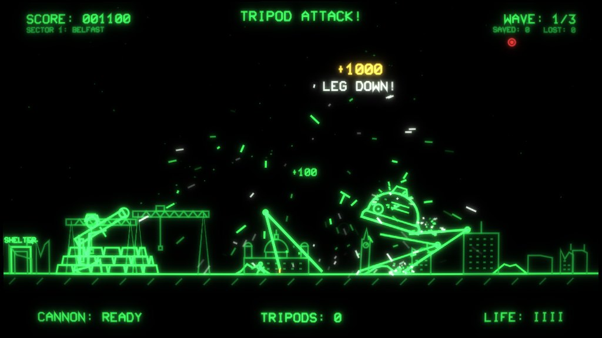

# Tripod Attack!


A Vectrex-style vector arcade game after H. G. Wells's *The War of the Worlds*, made in
**Godot 4.3** for Windows, Linux and Android. You are the artilleryman: one man, one rocket
launcher, a wall of sandbags, and the Martian fighting-machines striding in from the right.
Shoot their legs out and watch them come down. When you hear the cry, duck. Get the people to
shelter. Then take Europe back, one sector at a time.

Everything on screen is stroked lines on a black phosphor tube, with glow, scanlines, a barrel
curve and showers of sparks. All sound is synthesised in code in the manner of an early-80s
arcade board, so the project ships no audio files. Lines of text in the game are quoted from the
1898 novel, which is in the public domain.

## Get the game

Every push that changes this folder builds all three platforms automatically. Open the
repository's **Actions** tab, select the latest **Tripod Attack builds** run, and download from
its *Artifacts* section:

| Artifact | What it is |
|---|---|
| `tripod-attack-apk` | Android APK. Copy it to the phone and open it; allow installs from that app the first time. Landscape only. |
| `tripod-attack-windows` | Zip with `TripodAttack.exe` (64-bit, everything embedded). Unzip and run. |
| `tripod-attack-linux` | Zip with `TripodAttack.x86_64`. Unzip, `chmod +x`, run. |

The APK is a debug build with a throwaway key unless the repository has the
`ANDROID_RELEASE_KEYSTORE_BASE64`, `ANDROID_RELEASE_KEYSTORE_USER` and
`ANDROID_RELEASE_KEYSTORE_PASS` secrets (the same ones Neon Mega Tank uses), in which case it
is a signed release build that installs over the previous version. Tagging a commit `ta-v1.0.0`,
or running the workflow by hand with "Push the builds to itch.io" ticked, uploads the builds to
itch.io when the `BUTLER_API_KEY` secret is set.

### Run from source

1. Install [Godot 4.3](https://godotengine.org/download/archive/4.3-stable/) (standard build, not .NET).
2. Either open Godot, choose **Import**, pick `tripod-attack/project.godot` and press **F5**,
3. or run the launcher: `./play.sh ~/Godot_v4.3-stable_linux.x86_64` on Linux,
   `play.bat C:\path\to\Godot_v4.3-stable_win64.exe` on Windows.

On a fresh clone Godot has to import the project once to learn the script class names; the
launchers do that automatically. By hand it is `godot --headless --editor --quit --path tripod-attack`.

## Controls

| Input | Action |
|---|---|
| **Drag back and release** (mouse or touch) | Aim and fire, like a slingshot: drag away from the target, the further the harder. A dotted arc shows the shot. |
| **Tap / click** | Fire with the current aim |
| **Hold the left zone** (touch) or **right mouse button** | Duck behind the sandbags |
| **Space**, Shift or X / gamepad B or left shoulder | Duck |
| **Arrow keys**, WASD or left stick | Up/down aims the launcher, left/right sets the power |
| **Enter**, Z or F / gamepad A | Fire |
| **P**, Esc or Start | Pause |
| **M** | Mute |

On a phone the game runs in landscape. A dashed box on the left marks the duck zone once a touch
is detected, so one thumb ducks while the other drags and fires.

## How to fight a fighting-machine



* **Shoot the legs.** The hood is armour: rockets glance off it in sparks for a few points. Each
  leg takes a number of hits that grows through the campaign. A damaged leg sparks and flickers.
* **Break a leg and the machine falls.** The hood and the six leg segments are rigid bodies.
  While the machine walks they are frozen and driven by a procedural gait; the moment a leg breaks
  they are unfrozen, pinned together at the hips and knees, and Godot's physics engine brings the
  whole thing down. Every collapse is different. The hood hitting the ground throws sparks, debris
  and smoke, and anything under it is crushed, you included. The last machine of a wave falls in
  slow motion.
* **Listen for the cry.** Before the Heat-Ray, a machine stops, its lens glows red and it wails
  *Ulla*. That siren is your warning. The bright red beam then sweeps the whole field from the
  machine to the shelter. Standing when it reaches your sandbags costs a life. Ducked, it passes
  over you for a dodge bonus. Then get up and shoot again.
* **Protect the people.** Small figures run from the ruins towards the SHELTER door on the left.
  Each one through the door is worth 200 points (400 for a parent carrying a child). The beam burns
  anyone in the open, your own rocket blasts kill, and a falling tripod crushes. When the cry
  sounds, people near a rubble pile hide behind it until the beam has passed.
* **Hold the line.** A machine that reaches the sandbags stamps the position flat, costs a life and
  is driven back a few paces. Four lives to start, one more for each sector cleared (up to six).

The buildings behind you burn and fall when the beam catches them, so a long fight leaves the city
in ruins.

## The campaign: take Europe back


The map shows the Martian advance across the British Isles and Europe as a chain of ten sectors.
Red paths with marching tripods are theirs; green sectors are yours again. Each sector is three
waves, and every sector raises the machines' speed, armour, and how often they fire. The third wave
from Edinburgh onwards brings a larger machine. Each city has its own vector skyline:

| # | Sector | On the skyline |
|---|---|---|
| 1 | Belfast | Samson and Goliath, the City Hall, the Albert Clock |
| 2 | Edinburgh | the Castle on its rock, the Scott Monument, St Giles' |
| 3 | Liverpool | the Liver Building and its birds, the Anglican Cathedral, Radio City |
| 4 | London | Tower Bridge, St Paul's, Big Ben, the London Eye (turning) |
| 5 | Paris | the Arc de Triomphe, the Eiffel Tower, Notre-Dame |
| 6 | Amsterdam | windmills (turning), canal houses, the Westerkerk |
| 7 | Berlin | the Brandenburg Gate, the Fernsehturm, the Reichstag |
| 8 | Vienna | the Stephansdom, the Riesenrad (turning), the Karlskirche |
| 9 | Rome | the Colosseum, St Peter's, umbrella pines |
| 10 | Athens | the Acropolis and the Parthenon, Lycabettus |

Lose all your lives and the Martians retake the last sector you liberated; the line on the map
falls back and you fight for it again. Progress and high scores are saved in the user data folder
(`user://tripod_attack.cfg`), so you can continue a campaign later. Clear Athens and Europe is free.

**Endless mode** unlocks when the campaign is complete. It is set in Belfast, and the waves never
stop: more machines, tougher legs, shorter warnings, bigger ones every other wave, an extra life
every third wave. Campaign and endless high scores are kept separately.


## Sound

Every sound is built from square, saw and noise voices through swept filters, a cabinet echo and a
soft clip, rendered into `AudioStreamWAV`s by GDScript on a background thread when the game starts
(about three seconds on a desktop; the title screen says "warming up the sound board" until it is
done). Listen to [`docs/audio-preview.mp3`](docs/audio-preview.mp3): interface blips, the rocket
launch and explosion, rockets ringing off a leg and glancing off the hood, footsteps, the siren
cry followed by the Heat-Ray, screams and burning, a leg breaking and the collapse, a rescue, the
wave fanfare, being hit, the sandbags stamped flat, the wave alarm, eight bars of the battle theme,
and the sector-cleared, game-over and victory jingles.

The siren is four detuned saw and square oscillators with vibrato, driven through a wave-shaper and
a band-pass filter that sweeps up and back down, over a sub-bass drone; shorter warnings in later
sectors play it faster and higher. The Heat-Ray is filtered noise under a high resonant whine.
Music is a sixteen-step sequencer with bass, lead, kick, snare and hat patterns; there are looping
themes for the title, the map and the battle.

## How it is built

| File | What it is |
|---|---|
| `scenes/main.tscn`, `scripts/main.gd` | the state machine (title, map, briefing, play, cleared, game over, victory), input, camera shake and the CRT pass |
| `scripts/battlefield.gd` | the field: ground, waves, spawning, rockets (ray-cast against the machines), the Heat-Ray's effects, scoring |
| `scripts/tripod.gd` | the fighting-machine: rigid-body parts, two-bone IK gait, siren and beam, collapse with `PinJoint2D`s |
| `scripts/player.gd`, `civilian.gd`, `rocket.gd` | the artilleryman, the people, the rockets |
| `scripts/skyline.gd` | the ten city skylines as polylines, ruined filler buildings, burning and crumbling |
| `scripts/screens.gd` | the title, map, briefing, HUD and end screens |
| `scripts/sfx.gd` (autoload `Sfx`) | the synthesiser, sound effects and music sequencer |
| `scripts/game_state.gd` (autoload `G`) | score, lives, campaign progress, high scores, save file |
| `scripts/vec.gd` | drawing helpers and the stroke font every letter and digit is drawn with |
| `scripts/euro_map.gd`, `wells.gd`, `consts.gd` | the coastline and sectors, the quotations, the screen layout |
| `shaders/crt.gdshader` | glow from blurred mips of the screen, barrel curve, scanlines, vignette, flash |
| `scripts/headless_test.gd`, `scripts/demo_shots.gd` | the smoke test and the screenshot demo, attached when the game is started with `-- --smoke-test` or `-- --shots=DIR` |
| `tools/` | `screenshots.sh` (runs the demo under a virtual display) and `render_audio_preview.gd` (renders the sound board to a WAV) |

The game is drawn at 1024 x 576 and scaled to the window with black bars (`canvas_items` stretch,
aspect `keep`). It uses the GL Compatibility renderer so it runs on old GPUs and every Android
device.

### Checks

The smoke test drives the whole game headlessly: title, map, briefing, a rocket sweep that breaks
a leg and collapses a machine, the siren-then-fire cycle costing a standing player a life and
sparing a ducked one, a two-and-a-half-minute soak, sector cleared, the Martians retaking a sector
on game over, victory, endless mode, and the sound board rendering. It runs in about twenty
seconds and the CI workflow runs it against the exported Linux build:

```
godot --headless --fixed-fps 60 --path tripod-attack -- --smoke-test
```

Screenshots of every screen (needs `xvfb-run` and Mesa):

```
tripod-attack/tools/screenshots.sh ~/Godot_v4.3-stable_linux.x86_64 /tmp/shots
```

The audio preview:

```
godot --headless --path tripod-attack -s tools/render_audio_preview.gd -- /tmp/preview.wav
ffmpeg -i /tmp/preview.wav -q:a 4 tripod-attack/docs/audio-preview.mp3
```
